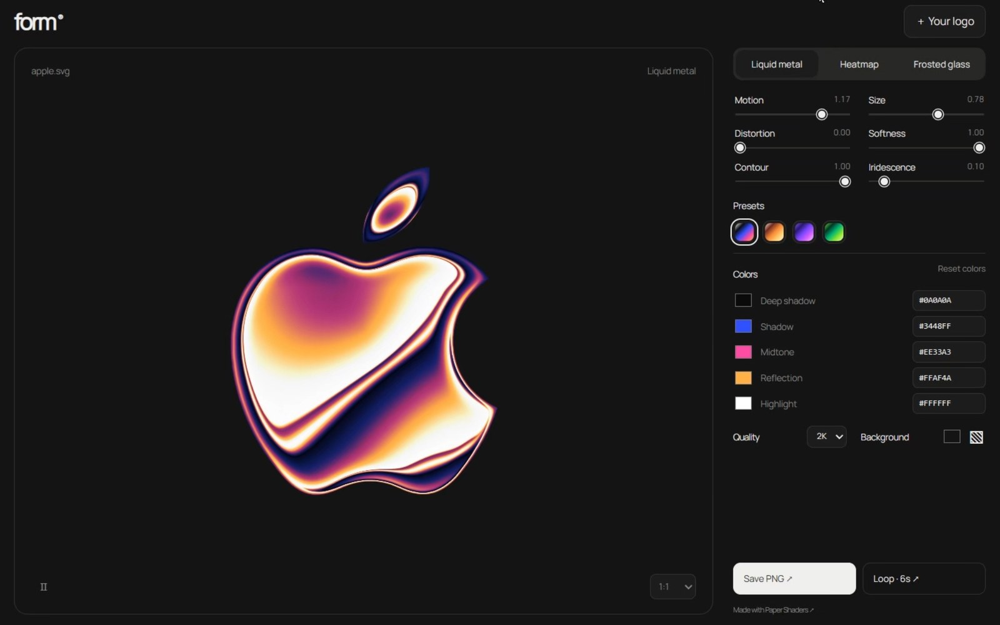
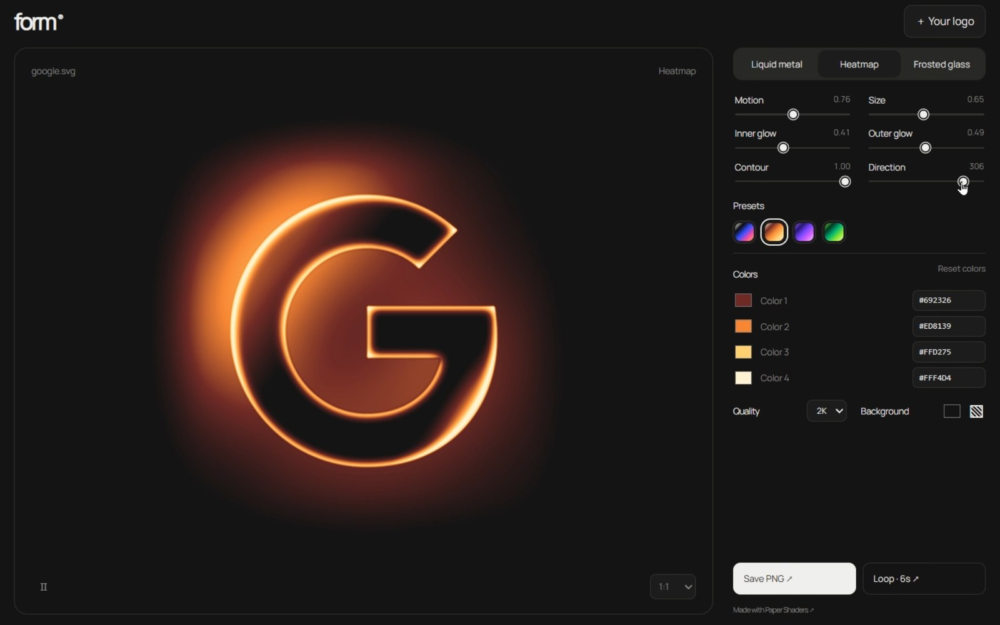
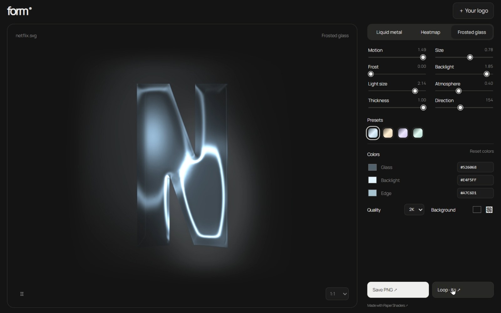

# Form — Logo Material

A local browser tool for designers: upload an SVG or PNG with a transparent background and turn the logo into animated liquid metal, Heatmap or frosted glass. You can change colors and light, and save a PNG or six-second seamless video loops in 2K / 4K.

## Screenshots

**Liquid metal**



**Heatmap**



**Frosted glass**



## Running from source

1. Install Node.js 22.12 or newer: https://nodejs.org/
2. Get the project folder (clone the repository or unpack the archive) into a regular folder.
3. Open a terminal in this folder and run:

```sh
npm ci
npm run dev
```

Open http://127.0.0.1:4180/ . On Windows you can run START-WINDOWS.cmd instead of the commands. Keep the server window open; stop it with Ctrl+C. The first npm install needs the internet. The editor itself processes images locally, with no API keys and no file-upload server.

If port 4180 is busy:

```sh
npx vite --host 127.0.0.1 --port 4181 --strictPort
```

## Build

```sh
npm run build
npm run preview
```

The ready build is already in dist/. Preview opens at http://127.0.0.1:4181/ . Do not open index.html by double-clicking: an HTTP server is required. The contents of dist/ can be placed on static hosting. The sources are needed for editing and rebuilding.

## How to use

- Your logo: upload an SVG, PNG or WebP with a transparent background; you can also drag the file onto the page.
- Three materials: Liquid metal, Heatmap, Frosted glass.
- Presets are ready-made variants; Colors are the separate colors of the material.
- Glass offers frost, backlight, light size, atmosphere, thickness and direction. Glass / Backlight / Edge interact with each other.
- Quality: 2K or 4K on the long side. 1:1, 16:9 and 9:16 are chosen at the bottom of the preview.
- Save PNG saves the current frame. The button with the checkerboard icon turns on a transparent background.
- Loop · 6s creates a WebM: exactly 180 frames, 30 fps, 6 seconds. The export uses closed-loop motion, so the pace is slightly adjusted to fit a full cycle. Motion 0 gives a still loop.
- Video needs browser support for WebCodecs and VP9/VP8. Tested in Chromium; for reliable transparency use PNG, since alpha-channel support in video depends on the browser and codec.

Starting Heatmap: Motion 1.50, Size 0.65, Inner glow 0.41, Outer glow 0.49, Contour 0.46, Direction 306°. The interface is dark only; on desktop all settings and export are visible without scrolling.

4K is the resolution of the output canvas; processing of the source image and the effect map has its own detail limits. Settings are kept when switching materials within the current session, but are not a separately saved project.

## Hand over to Codex

Open the project folder in Codex and ask it to read CODEX_HANDOFF.md and README.md. The package contains all active sources and local resources. node_modules is not included: it is restored with `npm ci` from package-lock.json.

Experimental 3D versions, old backups, personal videos and temporary files are not part of the release. The current glass mode is a shader that preserves the original silhouette of the logo.

## Sources and licenses

Form is built on open-source components. Their licenses are included in `public/`:

- **Paper Shaders**: Apache License 2.0 ([public/PAPER-LICENSE.txt](public/PAPER-LICENSE.txt), [public/PAPER-NOTICE.txt](public/PAPER-NOTICE.txt)).
- **Mediabunny** (WebM export): Mozilla Public License 2.0 ([public/MEDIABUNNY-LICENSE.txt](public/MEDIABUNNY-LICENSE.txt)). Used as an npm dependency; source and documentation: https://mediabunny.dev
- **Manrope** (font): SIL Open Font License 1.1 ([public/MANROPE-OFL.txt](public/MANROPE-OFL.txt)).

The original posts by Stephen Haney and the Paper code are listed in [ORIGINALS.md](ORIGINALS.md). This tool is a local adaptation and extension of those effects; it is not an official Paper product.
